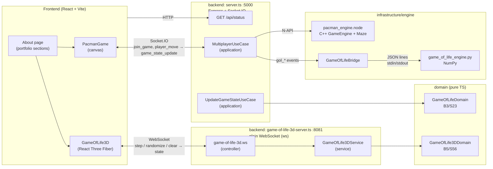

# Personal Web: portfolio site with live 3D Game of Life and multiplayer Pacman

Personal Web (formerly CV_WEB) is Emmanuel Valenciano's personal portfolio / CV website. It is a single-page
React app with a hero, technical focus, experience, education, skills and projects
sections. It also embeds two **live, server-driven demos**: a shared **3D Game of
Life** (16×16×16 volume rendered with React Three Fiber; the simulation runs on the
server over a WebSocket) and a **2-player Pacman** whose game logic is a **C++
engine** loaded into Node as a native addon. The TypeScript backend follows a
layered "clean architecture" layout. It also contains a **Python/NumPy** Game of
Life engine driven over stdin/stdout.

## Features

- Portfolio sections (profile, metrics, technical focus, experience, education,
  research interests, skills, projects), animated with Framer Motion and canvas effects.
- **3D Game of Life**: B5/S56 rules on a toroidal 16³ grid. The server owns the state,
  so every open browser sees the same simulation. Step / randomize / clear controls,
  orbit camera, auto-reconnect with exponential backoff.
- **Multiplayer Pacman**: matchmaking queue, server-authoritative 20 FPS game loop in
  C++ (N-API addon), arrow-key controls, pellet scoring.
- **Python NumPy engine** for a shared 2D Game of Life board (`gol_*` Socket.IO events)
  and a stateless 2D `next_gen` endpoint in TypeScript. The current UI uses neither;
  see [Known limitations](#known-limitations--roadmap).
- Graceful degradation: the backend still starts without the C++ addon (Pacman then
  replies `game_unavailable`) and without Python (2D shared board errors are logged).

## Tech stack

| Part | Technologies |
|---|---|
| Frontend | React 19, TypeScript, Vite 7, Tailwind CSS 4, Framer Motion, three.js + @react-three/fiber + @react-three/drei, socket.io-client |
| Backend | Node.js 22, TypeScript (tsx), Express 5, Socket.IO 4, ws, dotenv |
| Native engine | C++17, node-addon-api (N-API), node-gyp; CMake/CTest for unit tests |
| Python engine | Python 3.10+, NumPy |
| Tests / quality | Vitest, pytest, CTest, ESLint, ruff, `tsc --noEmit` |

## Architecture



Two backend processes serve the frontend. The 3D Game of Life runs on its own
plain-WebSocket server (port 8081); everything else runs on the Express +
Socket.IO server (port 5000). See [docs/ARCHITECTURE.md](docs/ARCHITECTURE.md)
for components, protocols and data flow.

## Project structure

```
Personal-Web/
├── backend/
│   ├── src/
│   │   ├── domain/            # Pure Game of Life rules (2D and 3D), no I/O
│   │   ├── application/       # Use cases: next_gen, multiplayer (Pacman + shared 2D board)
│   │   ├── services/          # Stateful 3D Game of Life service
│   │   ├── controllers/       # WebSocket controller for the 3D game
│   │   ├── main/              # Entry points: server.ts (:5000), game-of-life-3d-server.ts (:8081)
│   │   └── infrastructure/engine/
│   │       ├── cpp/           # C++ Pacman engine, N-API binding, binding.gyp, CMake tests
│   │       └── python/        # NumPy engine, Node bridge, pytest tests
│   ├── test/                  # Vitest suites
│   ├── .env.example
│   └── requirements*.txt
├── frontend/
│   ├── public/                # Images (profile photos, project thumbnails)
│   ├── src/
│   │   ├── features/          # about/ (portfolio page + data), game-of-life/, projects/ (Pacman)
│   │   ├── components/ui/     # Frame, ProjectCard, ContactModal, WireframeTree (canvas)
│   │   ├── layouts/           # Header, Footer, global CSS
│   │   ├── config/backend.ts  # Backend URLs
│   │   └── data/              # Contact data
│   └── .env.example
├── docs/ARCHITECTURE.md
└── package.json               # Stray root manifest (three.js deps only, see Known limitations)
```

## Setup

### Prerequisites

- **Node.js 22** (tested with 22.23) and npm 10
- **Python 3.10+** (tested with 3.13) for the NumPy engine and its tests
- For the optional C++ addon: a **C++17 compiler** (g++/clang, or MSVC Build Tools on
  Windows), **make**, and Python 3 (node-gyp uses it). **CMake 3.16+** is needed only
  for the C++ unit tests.

### Install

```bash
# Backend
cd backend
npm ci
python3 -m venv venv
venv/bin/pip install -r requirements-dev.txt     # Windows: venv\Scripts\pip ...
cp .env.example .env                              # optional, all values have defaults

# Optional: build the native Pacman engine (needs a C++ toolchain)
npm run build:engine
# If node-gyp cannot download Node headers (offline / proxy), point it to the local ones:
#   npm run build:engine -- --nodedir="$(dirname "$(dirname "$(which node)")")"

# Frontend
cd ../frontend
npm ci
cp .env.example .env.local                        # optional
```

### Environment variables

| Variable | Where | Default | Purpose |
|---|---|---|---|
| `PORT` | backend | `5000` | Express + Socket.IO port |
| `CORS_ORIGIN` | backend | `*` | Allowed origin(s), comma separated |
| `WS_PORT` | backend | `8081` | 3D Game of Life WebSocket port |
| `PYTHON_PATH` | backend | `venv/bin/python3`, then `python3` | Interpreter for the NumPy engine |
| `PACMAN_ENGINE_PATH` | backend | `src/infrastructure/engine/cpp/build/Release/pacman_engine.node` | Compiled addon |
| `VITE_BACKEND_HTTP_URL` | frontend | `http://<page host>:5000` | Express / Socket.IO URL |
| `VITE_BACKEND_WS_URL` | frontend | `ws://<page host>:8081` | 3D Game of Life WebSocket URL |

## Running

Use three terminals:

```bash
cd backend && npm run dev        # Express + Socket.IO on :5000 (Pacman, /api/status)
cd backend && npm run dev:3d     # 3D Game of Life WebSocket on :8081
cd frontend && npm run dev       # Vite dev server, http://localhost:5173
```

Open http://localhost:5173 and scroll to **Projects**. To play Pacman, open the
site in two tabs and click the Pacman card in both.

Production build: `cd frontend && npm run build` (output in `frontend/dist/`), and
`cd backend && npm run build` (compiles to `backend/dist/`; start it from `backend/`
so the engine paths resolve).

## Testing and quality checks

```bash
cd backend
npm test                 # Vitest: domain, services, multiplayer, Python bridge, addon (if built)
npm run test:py          # pytest: NumPy engine and JSON-lines protocol
npm run test:cpp         # CMake + CTest: Maze and GameEngine (no Node needed)
npm run typecheck        # tsc --noEmit over src/ and test/
venv/bin/ruff check src/infrastructure/engine/python

cd ../frontend
npm run lint             # ESLint
npm run build            # tsc -b + vite build
```

Bridge tests that need the real Python engine are skipped when `backend/venv` does
not exist (or `PYTHON_PATH` is unset). Addon tests are skipped when the addon has
not been built.

## Known limitations / roadmap

- The **shared 2D Game of Life board** (`gol_*` events, Python engine) and the
  stateless `next_gen` event exist only in the backend. No current frontend
  component uses them; an earlier 2D UI was replaced by the 3D view.
- The 3D game needs a **second backend process** on its own port. Merging it into
  the main HTTP server (shared port, `ws` `noServer` upgrade) would simplify deployment.
- Pacman has no win/lose condition: ghosts do not collide with players, and the game
  ends only when a player disconnects.
- The 3D view renders one mesh per live cell; an `InstancedMesh` would scale better.
  The GameOfLife3D chunk is about 900 kB minified (three.js), and Vite warns about it.
- `contact.data.ts` has placeholder Google Scholar / ORCID links (TODOs), and the
  "Download CV" button points to `/resume.pdf`, which is not in the repo.
- The root `package.json` / `package-lock.json` only list three.js packages, which
  `frontend/` already declares. They look like a stray `npm install` at the repo root
  and are not used by either app.
