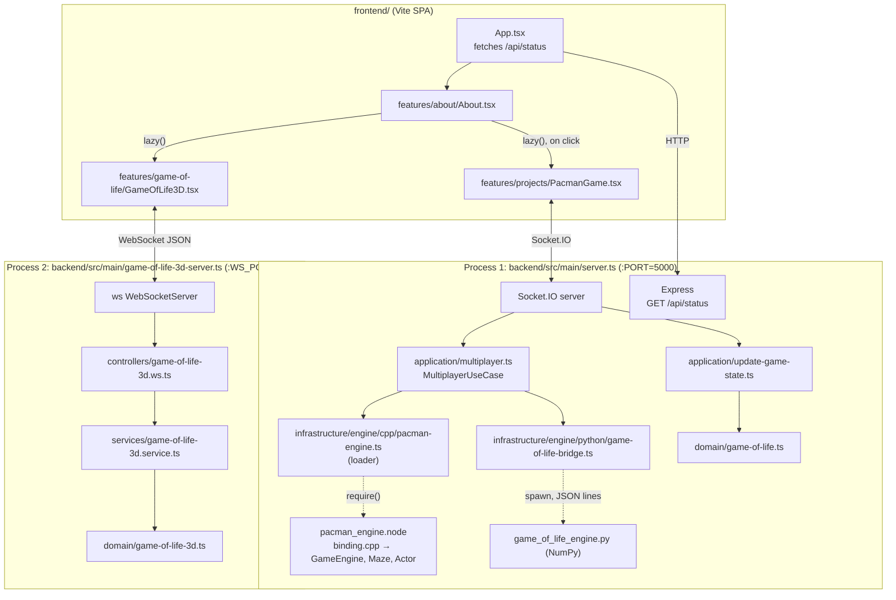

# Architecture

This document describes how Personal Web is built today, as it is in the code. For setup
and commands, see the [README](../README.md).

## 1. Overview



## 2. Frontend

| Module | Responsibility |
|---|---|
| `App.tsx` | Layout shell (Header, About, Footer). Calls `GET /api/status` once and shows a status badge if the backend answers. |
| `features/about/About.tsx` + `about.data.ts` | The portfolio itself: hero, metrics, technical focus, experience, education, research interests, skills and the projects lab. Content lives in `about.data.ts` / `data/contact.data.ts`. |
| `features/game-of-life/GameOfLife3D.tsx` | Opens a raw `WebSocket` to `BACKEND_WS_URL`, renders live cells as cubes in a `<Canvas>` with `OrbitControls`, sends commands, reconnects with backoff (3 s → 15 s). |
| `features/projects/PacmanGame.tsx` | Full-screen modal. Opens a Socket.IO connection, joins matchmaking, draws server state on a 2D canvas, sends arrow keys. |
| `components/ui/*` | Presentational pieces: `Frame`, `ProjectCard`, `ContactModal`, `WireframeTree` (animated canvas). |
| `config/backend.ts` | Backend URLs from `VITE_BACKEND_*` or the page hostname. |

Both games are code-split with `React.lazy`, so three.js is only downloaded when the
projects section renders the 3D view.

## 3. Backend layers

The backend uses a layered layout. Dependencies point inwards: `main → controllers /
application → services → domain`, with `infrastructure` used by `application`.

| Layer | Files | Notes |
|---|---|---|
| **domain** | `game-of-life.ts`, `game-of-life-3d.ts` | Pure functions over `number[][]` / `number[][][]`. Toroidal wrap-around. 2D: B3/S23. 3D: B5/S56, because Conway's rules in 3D (26 neighbours) explode or die out at once. `isValidGrid2D` guards untrusted payloads. |
| **services** | `game-of-life-3d.service.ts` | Holds the single shared 3D volume (16³, ~20 % initial density) and exposes `step / randomize / clear`. The random source can be injected for tests. |
| **application** | `update-game-state.ts` | Stateless 2D `next_gen`: the client sends a grid and gets the next one back. |
| | `multiplayer.ts` | Pacman matchmaking, rooms and game loops; shared 2D board state and its 200 ms loop. Engines are constructor-injected (defaults: native addon, Python bridge). |
| **controllers** | `game-of-life-3d.ws.ts` | Translates WebSocket JSON messages into service calls and broadcasts the state. |
| **main** | `server.ts`, `game-of-life-3d-server.ts` | Composition roots: read env vars, create servers, wire Socket.IO events to use cases. `server.ts` also acts as the Socket.IO controller (event handlers are registered inline). |
| **infrastructure** | `engine/cpp/*`, `engine/python/*` | Adapters to non-TypeScript engines. |

## 4. Protocols

### 4.1 3D Game of Life (plain WebSocket, port 8081)

| Direction | Message |
|---|---|
| server → client (on connect, and broadcast after each command) | `{"type":"state","grid":number[16][16][16]}` |
| client → server | `{"type":"step"}`, `{"type":"randomize"}`, `{"type":"clear"}` |
| server → sender only | `{"type":"error","message":"Invalid message" \| "Unknown command"}` |

All connections share **one** service instance, so a command from any viewer updates
every viewer.

### 4.2 Socket.IO (port 5000)

| Event (client → server) | Effect | Server → client |
|---|---|---|
| `join_game` | Enqueue for Pacman; with 2 queued, create a room, join both sockets, start a 50 ms loop | `waiting_for_opponent`, `game_start {roomId, opponentId}`, then `game_state_update` to the room; `game_unavailable` if the addon is not loaded |
| `player_move` `'up'\|'down'\|'left'\|'right'` | `engine.movePlayer` (other values are ignored) | (next `game_state_update`) |
| `leave_game` / `disconnect` | Leave the queue; end the room | `player_disconnected` to the room |
| `next_gen` `number[][]` | Validate, then `GameOfLifeDomain.nextGeneration` | `game_update` or `game_error` |
| `gol_toggle_cell {x,y,value}` | Set a cell on the shared 50×50 board | `gol_update {grid}` to all |
| `gol_start` / `gol_stop` / `gol_reset` | Start/stop the 200 ms loop through the Python engine, or clear the board | `gol_update {grid}` to all |

`GET /api/status` → `{ message, status, pacmanEngine: "available"|"unavailable", timestamp }`.

### 4.3 Node ↔ Python engine

`GameOfLifeBridge` spawns `game_of_life_engine.py` once (lazily) and talks
newline-delimited JSON:

```
→ {"command":"next","grid":[[0,1,...],...]}
← {"grid":[[...]]}        or        ← {"error":"..."}
```

The engine answers **exactly one line per request, in order**. The bridge keeps a
FIFO of pending requests and buffers stdout until `\n` (large grids span several
pipe chunks). A timed-out request stays in the queue until its late answer arrives,
so that answer is not given to the next caller. If the interpreter is missing or the
process exits, pending requests are rejected and the next call respawns the process.

### 4.4 Node ↔ C++ engine

`binding.cpp` wraps `GameEngine` in a JS class `PacmanEngine` (node-addon-api):
`addPlayer(id)`, `removePlayer(id)`, `movePlayer(id, dir)`, `tick()`, `getState()`.
`pacman-engine.ts` loads the addon with `createRequire`. If the `.node` file is
missing, it returns `null` instead of throwing, and `MultiplayerUseCase` disables Pacman.

C++ model:

- `Maze`: fixed 15×15 tile matrix indexed `[y][x]`. Tiles are `0` empty, `1` wall,
  `2` pellet.
- `Actor`: continuous position in tile units (`x.5` = tile centre) plus a direction
  (`0` right, `1` down, `2` left, `3` up).
- `GameEngine`: owns the maze, the players (keyed by socket id), their scores and four
  ghosts. `movePlayer` steps 0.15 tiles if the leading edge (±0.4) is not in a wall,
  then eats the pellet in the current tile (+10). `tick` steps each ghost 0.08 tiles
  and picks a random direction when it hits a wall.

## 5. State and concurrency

- All state is **in memory**: one 3D volume per WebSocket server process, one shared
  2D board, and one `GameEngine` per Pacman room. Restarting a process resets it.
- Node runs on a single thread, so there are no locks. The shared 2D loop skips a
  tick while the previous Python request is still in flight.
- Each Pacman room has its own `setInterval`, cleared when the room ends.

## 6. Testing

| Suite | Location | Covers |
|---|---|---|
| Vitest | `backend/test/` | 2D/3D rules (still lifes, oscillators, glider, wrap-around, B5/S56 thresholds), input validation, 3D service, multiplayer with a fake Socket.IO server and fake engine, Python bridge (real engine, concurrency, >64 KiB payloads, missing interpreter, timeout), addon loader and real addon when built |
| pytest | `backend/src/infrastructure/engine/python/tests/` | NumPy rules, validation, protocol (`handle_request`, `main`), subprocess run |
| CTest | `backend/src/infrastructure/engine/cpp/tests/` | Maze bounds and indexing, pellet eating and scoring, wall collisions, ghosts stay in bounds and all move |

## 7. Known architectural gaps

- `server.ts` mixes composition root and Socket.IO controller. A
  `controllers/socket.controller.ts` would mirror the 3D WebSocket controller.
- The 2D shared board and `next_gen` have no frontend consumer.
- The 3D game runs as a separate process and port instead of sharing the HTTP server.
- The Python and TypeScript 2D engines implement the same rules twice. Both are
  tested against the same patterns (blinker, glider, wrap-around), but nothing
  checks them against each other.
